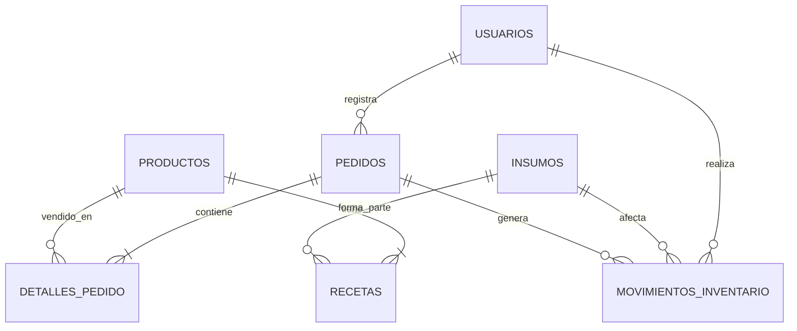

# API REST - Cafetería El Grano

API REST desarrollada con **Python**, **FastAPI**, **Pydantic** y **SQLAlchemy** para administrar una cafetería: usuarios, productos con receta, inventario de insumos, pedidos, ventas e historial de movimientos. Incluye autenticación con **JWT**, autorización por roles y un frontend sencillo para probar la integración.

---

## Integrantes del Equipo
- **Luis Rolando Aguilar Ortiz - 2121179**
- **Angel Emiliano Carmona Lozano - 2069119**
- **Liliana Valeria Ramos Avila - 2056778**
- **Dylan Isai Garcia Tovar - 2059489**
- **Diego Barrientos Gallegos - 2048051**

---

## Tecnologías
| Tecnología | Uso |
| :--- | :--- |
| Python 3.11+ | Lenguaje |
| FastAPI | Framework de la API y Swagger UI |
| Pydantic | Validación de datos de entrada y salida |
| SQLAlchemy 2 | ORM y conexión a la base de datos |
| SQLite | Base de datos (se puede cambiar a PostgreSQL o MySQL con `DATABASE_URL`) |
| PyJWT + bcrypt | Tokens JWT y hash de contraseñas |
| Poetry | Gestión de dependencias |
| HTML + CSS + JavaScript | Frontend de pruebas |

---

## Arquitectura
**Monolito modular en capas.** Cada módulo de negocio (`usuarios`, `productos`, `inventario`, `pedidos`, `reportes`, `auth`) tiene sus propias capas:

```
router.py      -> Endpoints HTTP (recibe la petición y devuelve la respuesta)
schemas.py     -> Modelos Pydantic (validación de entrada y salida)
service.py     -> Lógica de negocio y reglas
repository.py  -> Consultas a la base de datos (patrón Repository)
models.py      -> Tablas de SQLAlchemy
```

Patrones utilizados: **Repository** (`app/core/repository.py`), **Service Layer**, **Inyección de dependencias** (`Depends` de FastAPI) y **Unit of Work** (la sesión de SQLAlchemy confirma todo el pedido en una sola transacción).

```
PIA-Cafeteria/
├── app/
│   ├── main.py              # Crea la app, registra routers y manejo de errores
│   ├── seed.py              # Usuarios y datos de ejemplo
│   ├── core/                # Configuración, BD, seguridad, dependencias, excepciones
│   └── modules/
│       ├── auth/
│       ├── usuarios/
│       ├── productos/
│       ├── inventario/
│       ├── pedidos/
│       └── reportes/
├── frontend/                # index.html, styles.css, app.js
├── pruebas/                 # Colección de Postman
├── pyproject.toml
└── poetry.lock
```

---

## Requisitos Previos
- **Python 3.11** o superior.
- **Poetry** (`pip install poetry`).

---

## Instalación y Ejecución

1. **Clonar el repositorio:**
   ```bash
   git clone https://github.com/nomraclegna/Cafeter-a-El-Grano.git
   cd PIA-Cafeteria
   ```

2. **Instalar las dependencias:**
   ```bash
   poetry install
   ```

4. **Iniciar el servidor:**
   ```bash
   poetry run uvicorn app.main:app --reload
   ```

La primera vez se crea `cafeteria.db` con usuarios, insumos y productos de ejemplo. Si cambia la estructura de las tablas, borra `cafeteria.db` y se vuelve a crear al iniciar.

Si la terminal no reconoce `poetry`, usa `python -m poetry` en su lugar (por ejemplo `python -m poetry install`).

| Recurso | URL |
| :--- | :--- |
| Frontend | http://127.0.0.1:8000/app/ |
| Swagger UI | http://127.0.0.1:8000/docs |

### Usuarios de prueba
| Usuario | Contraseña | Rol |
| :--- | :--- | :--- |
| `admin` | `Admin123*` | admin |
| `cajero` | `Cajero123*` | cajero |

En Swagger, usa el botón **Authorize** con estos datos para obtener el token.

---

## Endpoints

Todas las rutas usan el prefijo `/v1/api`. Todas requieren token excepto el login.

### 1. Autenticación
| Método | Ruta | Rol | Descripción |
| :--- | :--- | :--- | :--- |
| `POST` | `/auth/login` | Público | Inicia sesión y devuelve el token JWT |
| `GET` | `/auth/me` | Cualquiera | Datos del usuario autenticado |

### 2. Usuarios
| Método | Ruta | Rol | Descripción |
| :--- | :--- | :--- | :--- |
| `GET` | `/usuarios` | admin | Listar usuarios |
| `GET` | `/usuarios/{id}` | admin | Consultar un usuario |
| `POST` | `/usuarios` | admin | Registrar usuario |
| `PUT` | `/usuarios/{id}` | admin | Actualizar nombre, contraseña, rol o estado |
| `DELETE` | `/usuarios/{id}` | admin | Desactivar usuario |

### 3. Productos
| Método | Ruta | Rol | Descripción |
| :--- | :--- | :--- | :--- |
| `GET` | `/productos` | Cualquiera | Listar productos (filtros `categoria`, `solo_activos`) |
| `GET` | `/productos/{id}` | Cualquiera | Consultar producto con su receta |
| `POST` | `/productos` | admin | Registrar producto con receta |
| `PUT` | `/productos/{id}` | admin | Actualizar datos, precio, estado o receta |
| `DELETE` | `/productos/{id}` | admin | Desactivar producto |

### 4. Inventario
| Método | Ruta | Rol | Descripción |
| :--- | :--- | :--- | :--- |
| `GET` | `/inventario/insumos` | Cualquiera | Listar insumos con indicador de stock bajo |
| `GET` | `/inventario/insumos/{id}` | Cualquiera | Consultar insumo |
| `POST` | `/inventario/insumos` | admin | Registrar insumo con stock inicial |
| `PUT` | `/inventario/insumos/{id}` | admin | Actualizar nombre, stock mínimo o estado |
| `DELETE` | `/inventario/insumos/{id}` | admin | Desactivar insumo |
| `POST` | `/inventario/insumos/{id}/entradas` | admin | Registrar entrada de mercancía |
| `POST` | `/inventario/insumos/{id}/mermas` | admin | Registrar merma (pérdida) |
| `GET` | `/inventario/movimientos` | admin | Historial de movimientos (filtros `insumo_id`, `tipo`, `limite`) |

### 5. Pedidos
| Método | Ruta | Rol | Descripción |
| :--- | :--- | :--- | :--- |
| `POST` | `/pedidos` | Cualquiera | Registrar pedido (con notas opcionales por producto): calcula total y cambio, y descuenta inventario |
| `GET` | `/pedidos` | Cualquiera | Listar pedidos (filtros `estado`, `fecha_inicio`, `fecha_fin`) |
| `GET` | `/pedidos/{id}` | Cualquiera | Consultar pedido |
| `PATCH` | `/pedidos/{id}/estado` | Cualquiera | Avanzar a `en_preparacion` o `entregado` |
| `POST` | `/pedidos/{id}/cancelar` | admin | Cancelar pedido pendiente y regresar insumos |

### 6. Reportes
| Método | Ruta | Rol | Descripción |
| :--- | :--- | :--- | :--- |
| `GET` | `/reportes/ventas` | admin | Total vendido, ticket promedio y ventas por método de pago |
| `GET` | `/reportes/productos-mas-vendidos` | admin | Ranking de productos por unidades vendidas |
| `GET` | `/reportes/stock-bajo` | admin | Insumos en o por debajo del stock mínimo |

---

## Base de Datos



---